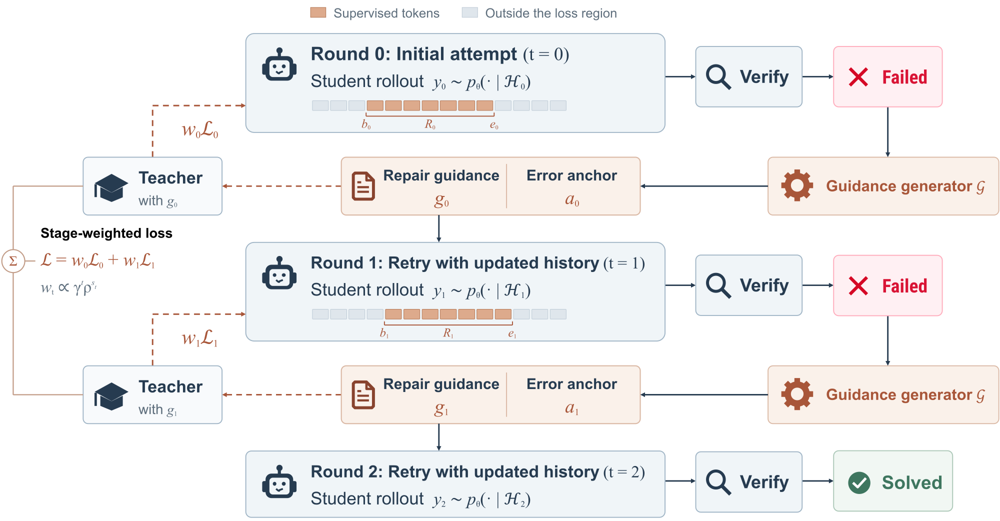
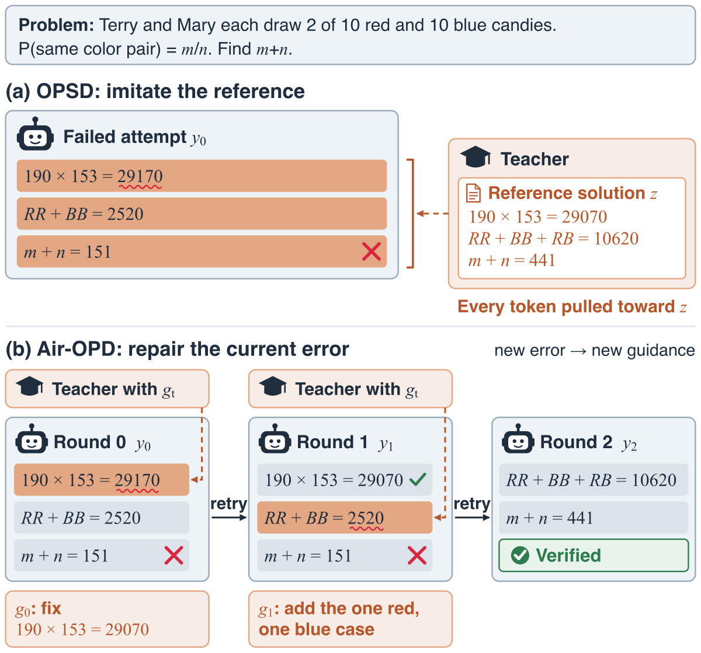
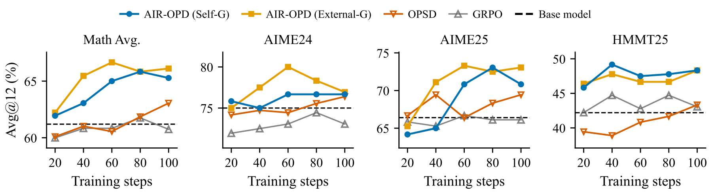

<div align="center">

<h1>Learning from Evolving Errors:<br>Adaptive Iterative Repair for On-Policy Distillation</h1>

<p>
  <strong>AIR-OPD</strong> turns failed on-policy rollouts into learnable error-to-repair transitions via targeted
  answer-free repair guidance, error-aligned corrective-mass span supervision, and outcome-aware stage weighting.
</p>

<p>
  <a href="https://middle-chunjie.github.io/air-opd-page/">
    
  </a>
  <a href="https://arxiv.org/abs/2610.02700">
    
  </a>
  <a href="https://arxiv.org/pdf/2610.02700">
    
  </a>
  <a href="LICENSE">
    
  </a>
</p>

<p>
  <a href="#-highlights">Highlights</a> &nbsp;·&nbsp;
  <a href="#-how-air-opd-works">Method</a> &nbsp;·&nbsp;
  <a href="#-main-results">Main Results</a> &nbsp;·&nbsp;
  <a href="#-quickstart-installation--training">Training &amp; Eval</a> &nbsp;·&nbsp;
  <a href="#-repository-layout">Repository Layout</a> &nbsp;·&nbsp;
  <a href="#-citation">Citation</a>
</p>

<br>



<p>
  <sub>
    <b>Overview of AIR-OPD:</b> When an on-policy rollout <i>y<sub>t</sub></i> fails verification, guidance generator <i>G</i> quotes the earliest flaw verbatim as anchor <i>a<sub>t</sub></i> and synthesizes answer-free guidance <i>g<sub>t</sub></i>. A frozen teacher conditioned on <i>g<sub>t</sub></i> supervises only the error-aligned region <i>R<sub>t</sub> = y<sub>t</sub>[b<sub>t</sub>:e<sub>t</sub>]</i> before the student retries on policy.
  </sub>
</p>

</div>

> [!IMPORTANT]
> **TL;DR:** Applying standard OPSD only to failed rollouts *hurts* performance (`63.1% → 62.5%`). **AIR-OPD** replaces static full-reference conditioning with targeted repair guidance $g_t$, isolates supervision to the error-aligned span $R_t = y_t[b_t:e_t]$, and reinforces rounds whose immediate retry passes verification — boosting **Qwen3-4B** to **65.8% (`Self-G`) / 66.7% (`External-G`)** Math Avg., outperforming **Qwen3-8B GRPO (`64.0%`)** and **Qwen3-8B OPSD (`64.7%`)** while preserving OOD generalization.

---

## ✨ Highlights

| 📈 +3.6 pts Math Avg | 🛡️ Zero OOD Collapse | ⚡ 2.5× Convergence | 🪞 Self-G (0 Extra Models) |
| :--- | :--- | :--- | :--- |
| Up to **+3.6 pts** over OPSD (**+5.5** over Base); 4B `AIR-OPD` (`66.7%`) beats 8B OPSD (`64.7%`) &amp; 8B GRPO (`64.0%`) | Preserves Base OOD within **0.1–0.4 pts** (and reaches **61.1%** / **+0.1** on 8B), vs. SFT (`−9.6 to −9.8`) &amp; OPSD (`−1.4 to −1.9`) | Matches or surpasses 100-step OPSD by **Step 40** while supervising only **~1/3** as many trajectories | `AIR-OPD (Self-G)` uses the student policy itself to diagnose &amp; guide repairs, already gaining **+2.7 / +2.2 pts** over OPSD (`4B / 8B`) |

---

## 🧠 How AIR-OPD Works

Prior post-training methods either assign one sequence-level scalar reward (`RLVR / GRPO`) or condition the teacher on a complete static solution $z$ across every token (`OPSD`). **AIR-OPD** decomposes failure supervision into three synergistic pillars:

1. **Multi-Round Adaptive Repair (`§3.1` · `air_opd/core/`):** Up to $K=3$ rounds, generator $\mathcal{G}(q, z, \mathcal{H}_t, y_t)$ diagnoses the earliest causal error, quotes it verbatim as anchor $a_t$, and produces concise, answer-free guidance $g_t$ under either **`Self-G`** (student policy) or **`External-G`** (`Qwen3.5-27B`).
2. **Error-Aligned Corrective-Mass Span (`§3.2` · Endpoint Rule):** Starts supervision at $b_t$ (exact match of $a_t$) and picks the earliest blank-line block boundary $e_t$ retaining $\ge (1-\epsilon)$ ($\epsilon = 0.10$) of positive teacher–student corrective probability mass $`C_{t,j} = \sum_{v \neq y_{t,j}} [p_{\mathrm{T}}(v\mid\mathcal{H}_t,g_t,y_{t,\lt j}) - p_\theta(v\mid\mathcal{H}_t,y_{t,\lt j})]_+`$ — reusing logits already computed for KL loss with **zero extra forward passes**.
3. **Outcome-Aware Stage Weighting (`§3.3` · `air_opd/opsd/`):** Combines temporal decay $\gamma^t$ and an outcome bonus $\rho^{s_{n,t}}$ ($s_{n,t} = \mathbb{I}[V(y_{n,t+1}) = 1]$, default $\gamma = 0.8, \rho = 1.5$) normalized per trajectory ($\sum_t w_{n,t} = 1$), so resolved intermediate repairs are never discarded.

<div align="center">
  
</div>

---

## 📊 Main Results

Evaluated without test-time guidance across competition mathematics (**Avg@12** on **AIME24**, **AIME25**, **HMMT25**) and out-of-distribution generalization (**Avg@4** on **MMLU-Pro**, **GPQA Diamond**) after 100 optimizer steps on **DAPO-Math-17K** (`15,650` verified problems; GRPO trained for `500 steps × 8 rollouts`):

| Backbone | Method | AIME24 | AIME25 | HMMT25 | Math Avg. | Δ vs. OPSD | MMLU-Pro | GPQA Diamond | OOD Avg. |
| :--- | :--- | :---: | :---: | :---: | :---: | :---: | :---: | :---: | :---: |
| **Qwen3-4B** | Base Model | `75.0` | `66.4` | `42.2` | `61.2` | `−1.9` | `51.5` | **`62.9`** | **`57.2`** |
| | SFT *(Offline Reference)* | `70.6` | `61.4` | `42.8` | `58.2` | `−4.9` | `43.1` | `52.0` | `47.6` |
| | GRPO *(Outcome RLVR)* | `75.6` | `67.5` | `43.9` | `62.3` | `−0.8` | `51.3` | `62.4` | `56.8` |
| | OPSD *(Full Ref-Conditioned)* | `76.4` | `69.4` | `43.3` | `63.1` | `0.0` | `50.4` | `60.2` | `55.3` |
| | **`AIR-OPD (Self-G)`** | `76.7` | `73.1` | **`47.8`** | `65.8` | **`+2.7`** | **`52.5`** | `61.4` | `56.9` |
| | **`AIR-OPD (External-G)`** | **`80.0`** | **`73.3`** | `46.7` | **`66.7`** | **`+3.6`** | `51.7` | `61.9` | `56.8` |
| **Qwen3-8B** | Base Model | `75.8` | `65.6` | `43.9` | `61.8` | `−2.9` | `57.9` | `64.1` | `61.0` |
| | SFT *(Offline Reference)* | `75.3` | `63.6` | `43.6` | `60.8` | `−3.9` | `46.5` | `55.8` | `51.2` |
| | GRPO *(Outcome RLVR)* | `76.9` | `69.2` | `45.8` | `64.0` | `−0.7` | `56.6` | **`64.5`** | `60.6` |
| | OPSD *(Full Ref-Conditioned)* | `77.8` | `69.7` | `46.7` | `64.7` | `0.0` | `57.4` | `61.7` | `59.6` |
| | **`AIR-OPD (Self-G)`** | `78.3` | `72.5` | **`49.7`** | `66.9` | **`+2.2`** | **`58.3`** | `63.5` | `60.9` |
| | **`AIR-OPD (External-G)`** | **`79.7`** | **`73.1`** | `49.4` | **`67.4`** | **`+2.7`** | `58.0` | `64.1` | **`61.1`** |

<div align="center">
  
</div>

---

## 🚀 Quickstart: Installation &amp; Training

### 1. Installation

Python `3.10` is assumed. Install dependencies via:

```bash
pip install -r requirements.txt
```

> [!NOTE]
> - `trl==0.26.0` is required because the trainer imports `trl.experimental.gold`.
> - `math_verify==0.9.0` (with the `antlr4_9_3` extra) is pinned in `air_opd/core/math_verifier_binary.py`.
> - Developed and validated against `torch 2.8.0+cu128`, `transformers 4.57.1`, `vLLM 0.11.0`, and `flash-attn 2.8.3` on 8×H100 GPUs.

### 2. Training (`Self-G` &amp; `External-G`)

Fill in `MODEL_PATH` (base model directory) and `TRAIN_JSONL` (annotated DAPO-Math-17K corpus) in the environment config, then launch distributed training via `accelerate` (`bf16` + `flash_attention_2`, 8 GPUs, `PER_DEVICE_BS=1`, `GRAD_ACCUM=4`, effective batch `32`):

```bash
# Self-Guidance: current student policy diagnoses & guides its own retries
bash scripts/train.sh configs/qwen3_4b_self_guidance.env

# External-Guidance: co-located Qwen3.5-27B vLLM engine (set SOCRATIC_REFLECTOR_MODEL_PATH)
bash scripts/train.sh configs/qwen3_4b_external_guidance.env
```

---

## 🗂️ Repository Layout

<details open>
<summary><strong>Directory Structure &amp; Key Modules</strong></summary>

```text
air_opd/              Training package: entry point, trainer, collator.
air_opd/core/         Verifiers, prompt renderers, multi-round repair state machine,
                      repair-guidance client, endpoint rule, checkpointing, trace replay.
air_opd/opsd/         On-policy self-distillation objective (generalized JSD)
                      and OPSD trainer derived from HuggingFace TRL.
configs/              Run configurations for Self-G and External-G.
configs/prompts/      Repair-guidance prompt bundle.
eval/                 Competition-math Avg@12 evaluator (`math_avg12.py`).
eval/ood/             OOD Avg@4 evaluators (MMLU-Pro, GPQA Diamond) & shard aggregators.
eval/ood/data/        MMLU-Pro subset (`mmlu_pro_1k_fixed.jsonl`) for Avg@4 evaluation.
assets/               README figures (framework, teaser, training dynamics).
scripts/              Training launcher (`train.sh`).
```

</details>

<details>
<summary><strong>📄 Training Corpus Format &amp; Rebuilding (DAPO-Math-17K)</strong></summary>

Training rows come from **DAPO-Math-17K** paired with reference solutions generated offline by GPT-5.5 and filtered by answer equivalence (`15,650` verified problems retained out of `17,398`). Each JSONL row follows this schema (synthetic illustration below):

```json
{
  "sample_id": "example-0001",
  "problem": "What is 17 + 25?",
  "answer": "42",
  "solution": "Add the ones digits: 7 + 5 = 12, so write 2 and carry 1. Add the tens digits together with the carry: 1 + 1 + 2 = 4. The result is 42."
}
```

To rebuild the corpus, generate a reference solution for each DAPO-Math-17K problem, verify its final answer with an answer-equivalence checker matching `air_opd/core/math_verifier_binary.py`, and keep verified rows only.

</details>

<details>
<summary><strong>🧪 Evaluation Commands (Math Avg@12 &amp; OOD Avg@4)</strong></summary>

#### Mathematical Reasoning (`Avg@12`, Seed `2026`)
Evaluated on **AIME24**, **AIME25**, and **HMMT25** (30 problems each; thinking enabled, temperature `1.0`, top-p `0.95`, `38,912` new tokens, `40,960` context). Checkpoints are evaluated at steps `20, 40, 60, 80, 100` (omit `--checkpoint_dir` for base model):

```bash
python3 eval/math_avg12.py \
  --base_model <base-model-dir> --checkpoint_dir <run>/checkpoint-<step> \
  --dataset aime24 --dataset_jsonl <path-to-aime24.jsonl> --seed 2026 --n 12 \
  --output_dir outputs/eval_aime24
```

#### MMLU-Pro (`Avg@4`, Seed `2026071201`)
Uses `eval/ood/data/mmlu_pro_1k_fixed.jsonl` (CC-BY-4.0; thinking template, `8,192` new tokens, `12,288` context). Run across all 4 shards (`--stride_index` `0..3` → `shard-0..shard-3`; omit `--adapter` and pass `--no_lora` for base model), then aggregate:

```bash
python3 eval/ood/mmlu_pro_avg4.py \
  --base <base-model-dir> --adapter <run>/checkpoint-<step> \
  --data eval/ood/data/mmlu_pro_1k_fixed.jsonl \
  --out outputs/eval_mmlu_pro/shard-0 --stride_index 0 --stride_count 4

python3 eval/ood/aggregate_mmlu_avg4.py --root outputs/eval_mmlu_pro --shards 4
```

#### GPQA Diamond (`Avg@4`, Seed `2026071201`)
Obtain `Idavidrein/gpqa` (`gpqa_diamond`, `198` questions) as JSONL (`id`, `question`, `options` keyed `"A"`–`"D"`, `answer`, `subdomain`). Uses raw prompt without chat template (`38,912` new tokens, `40,960` context). Run shards `0..3` (`shard-0..shard-3`; omit `--adapter` for base model), then aggregate:

```bash
python3 eval/ood/gpqa_avg4.py \
  --base <base-model-dir> --adapter <run>/checkpoint-<step> \
  --data <path-to-gpqa-diamond.jsonl> \
  --out outputs/eval_gpqa/shard-0 --stride_index 0 --stride_count 4

python3 eval/ood/aggregate_gpqa_avg4.py --root outputs/eval_gpqa --shards 4
```

</details>

---

## 📝 Citation

If you find **AIR-OPD** helpful in your research, please cite our arXiv preprint:

```bibtex
@article{li2026learning,
  title   = {Learning from Evolving Errors: Adaptive Iterative Repair for On-Policy Distillation},
  author  = {Li, Rui and He, Liyang and Zhang, Zheng and Huang, Zhenya and Zhu, Linbo and Liu, Qi},
  journal = {arXiv preprint arXiv:2610.02700},
  year    = {2026}
}
```

## 📄 License

Apache-2.0; the full text is in [`LICENSE`](LICENSE). `air_opd/opsd/trainer.py` is derived from HuggingFace TRL (Copyright 2020–2025 The HuggingFace Team, Apache-2.0) and retains its upstream license header.
